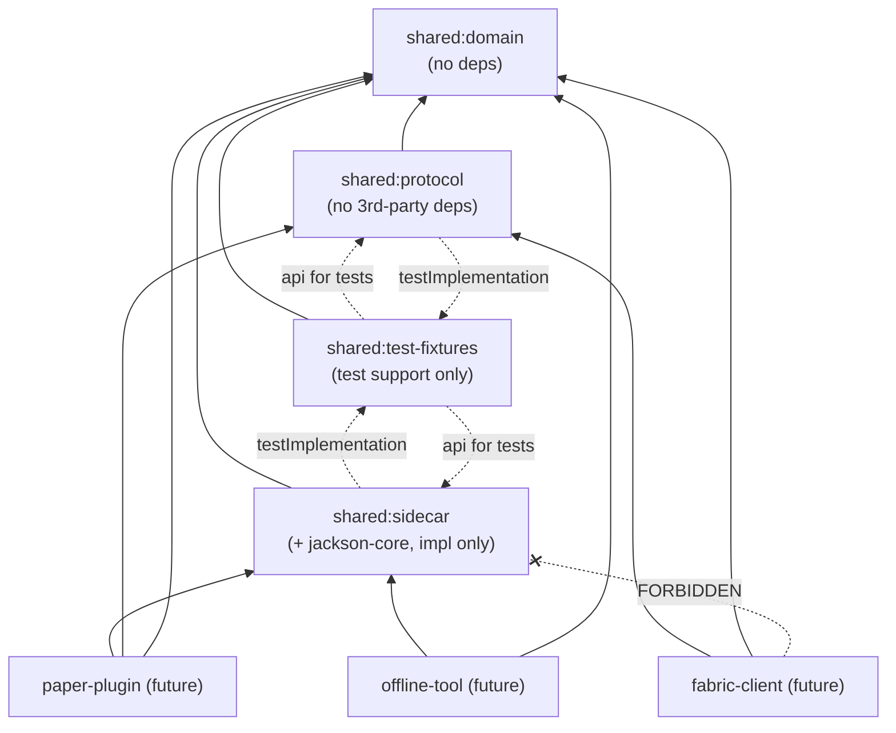

# Shared-Project Implementation Plan

- Milestone: **Prompt 00: Discovery and decisions**
- Date: 2026-09-27
- Status: historical. This is the Prompt 00 plan, kept as written; nothing in it was changed when the plan was carried out. For the current state of the shared project, see [`shared-release-audit.md`](shared-release-audit.md).

Related documents:

- [`docs/compatibility/version-matrix.md`](../compatibility/version-matrix.md)
- [ADR 0001: package and group ID](../decisions/0001-java-package-and-group-id.md) (Proposed, **blocking**)
- [ADR 0002: build and test toolchain](../decisions/0002-build-and-test-toolchain.md) (Proposed)
- [ADR 0003: sidecar JSON stack](../decisions/0003-sidecar-json-stack.md) (Proposed)

---

## 1. Repository inventory (verified)

### 1.1 Git

| Item | Finding |
|---|---|
| Branch | `main` (only local branch) |
| Remotes | `origin` → `github.com/kjmorse2/MCOneWorld.git`; `mcaselector-upstream` → `github.com/Querz/mcaselector.git` (branches fetched) |
| History | `fe226d06 Initialize MCOneWorld monorepo` (empty commit), then `7a9dd2d9 Add 'offline-tool/' from commit 'd31bee6a…'` (a `git subtree add` merge that carries all 1,611 upstream commits) |
| Subtree base | `git-subtree-split: d31bee6a` equals `mcaselector-upstream/master` **exactly**, with 0 commits of drift |
| Nested `.git` directories | **None.** No `.gitmodules`. MCA Selector is a proper `git subtree`: an ordinary tracked directory with upstream history merged in. |
| Uncommitted state | Untracked: `AGENTS.md`, `shared/` (the `AGENTS.md` and `prompts/` files). The planning docs in this milestone add only new files under `docs/`, so nothing overlaps. |
| Root files | `AGENTS.md` only. No root `LICENSE`, `README.md`, `.gitignore`, `settings.gradle(.kts)`, or `build.gradle(.kts)`. |

### 1.2 Gradle and Java

| Item | Root | `offline-tool/` |
|---|---|---|
| Build files | none | `build.gradle`, `settings.gradle` (Groovy DSL); `rootProject.name = 'mcaselector'` |
| Wrapper | none | Gradle **9.1.0** (`gradle-wrapper.properties`; no `distributionSha256Sum`) |
| Java level | — | `sourceCompatibility = 21`, no toolchain block (uses whatever JDK runs Gradle) |
| Plugins | — | `java`, `application`, `eclipse`, `idea`, `org.openjfx.javafxplugin 0.1.0`, `com.gradleup.shadow 9.2.2`, `com.github.ben-manes.versions 0.52.0`, `org.beryx.runtime 2.0.1` |
| Repositories | — | `mavenCentral()`, **`jitpack.io`**, and `plugins.gradle.org/m2` as a library repository |
| Notable dependencies | — | `com.github.Querz:NBT:13516d666a` (built on demand by JitPack from a commit hash), `gson 2.12.1`, `fastutil 8.5.15`, `log4j 2.26.1`, `slf4j-simple 2.0.19`, `groovy-jsr223 5.1.2`, `richtextfx 0.11.7`, `at.yawk.lz4:lz4-java 1.9.0`, `classindex 3.13`, `io.github.pcmind:leveldb 1.2`, JavaFX 21 |
| Dependency locking / verification | — | none / none |
| Tests | — | **No test sources.** `src/test` was removed upstream in `2bc0d929 "remove tests for now"`. The build still declares JUnit 6.0.1 test dependencies. |
| Formatting | — | none (tab-indented source; no Spotless or EditorConfig) |
| Static analysis | — | `-Xlint:deprecation -Xlint:unchecked` only |
| CI | none | `offline-tool/.github/workflows/release.yml`, which is **inert here**: GitHub runs only root `.github/workflows`, and the workflow targets `master`, uses Querz's secrets, and pushes to Querz's wiki |
| Size | — | 325 Java files under `net.querz.mcaselector` |

### 1.3 Local environment

- JDKs in `/usr/lib/jvm`: 11, 21, 25 (default, `25.0.4.1`), 26
- No global `gradle` on `PATH`
- Cached Gradle distributions: 9.2.0 and 9.4.1, plus 9.1.0 after this milestone's build run

## 2. MCA Selector subtree: licensing and attribution

| Component | License | Obligation |
|---|---|---|
| MCA Selector (`offline-tool/`) | MIT, © 2018–2026 Querz | Keep `offline-tool/LICENSE` intact and ship its text in any MCOneWorld Tool distribution that contains MCA Selector code. The existing build already copies `LICENSE` into jars. |
| Bundled third-party licenses (`src/main/resources/licenses/`) | Apache-2.0: gson, fastutil, commons-cli, groovy, log4j, classindex, leveldb, lz4-java. MIT: progressbar. BSD: richtextfx. | Preserve NOTICE text for the Apache-2.0 components when redistributing |
| Missing from `licenses/` (pre-existing upstream gap) | Querz NBT (MIT), slf4j-simple (MIT), JavaFX (GPL-2.0 + Classpath Exception, bundled by `jpackage`) | Add these before the first **MCOneWorld Tool** release. Tool-packaging task; not shared scope. |
| Minecraft server jars | Mojang EULA | Never commit them. This milestone downloaded two only to extract `version.json`, into a scratch directory outside the repository, and deleted them. |
| Proposed shared dependencies | Apache-2.0 (Jackson, JSpecify, AssertJ, Spotless, google-java-format, Error Prone); MIT (NullAway); EPL-2.0 (JUnit, jqwik; **test-only**, never distributed); GPL-2.0-with-CPE (JMH; **benchmark-only**, never distributed) | No copyleft code in any shipped shared artifact |

**No licensing incompatibility was found.** MIT is compatible with any license the owner picks for MCOneWorld. However, **MCOneWorld itself has no license yet** (question Q6).

## 3. Discrepancies and conflicts found

1. **Shared directory names differ between the instruction files.**
   - Root `AGENTS.md` §4 shows `shared/{schema,protocol,test-fixtures}`.
   - `shared/AGENTS.md` shows `shared/{domain,sidecar,protocol,test-fixtures}`.

   Root §4 allows names to evolve, and `shared/AGENTS.md` is the more specific file, so this plan uses **`domain`, `sidecar`, `protocol`, `test-fixtures`**. Confirmation requested (Q9).
2. **The root file is the family prefix.** Root `AGENTS.md` is titled "Shared `AGENTS.md` Prefix", and `shared/AGENTS.md` refers to "the root `AGENTS.md` and the shared family prefix" as if they were two documents. In this repository they are one file, so no action is needed. Noted so future agents don't look for a second file.
3. **The `shared/prompts/` directory sits inside the Gradle container `shared/`.** This is harmless. Gradle subprojects will be `shared/domain`, and so on; `prompts/` is not a project.
4. **The MCA Selector build conflicts with the monorepo rules.** The offline tool's build violates several monorepo rules:
   - Groovy DSL instead of Kotlin DSL
   - its own wrapper on 9.1.0, versus the proposed 9.8.0
   - a JitPack repository, where a commit-hash artifact is built on demand and isn't reproducible from Maven Central
   - `plugins.gradle.org` used as a library repository
   - no locking or verification
   - `--release 21`, while Paper and Fabric need 25
   - `rootProject.name = 'mcaselector'`
   - JavaFX pinned implicitly to `"$java.sourceCompatibility"`
   - `shadowJar.minimize` excludes `org.lz4:lz4-java`, but the real coordinate is `at.yawk.lz4:lz4-java`, so the exclusion probably doesn't apply (this runtime effect is not verified)

   **Resolution proposed:** leave `offline-tool/` untouched and outside the root build for now (ADR 0002). Integration is part of the deferred "fork versus library versus subprocess" decision (root §22). Editing upstream build files now would make every future `git subtree pull` conflict.
5. **Java level split.** Minecraft and Paper 26.x need Java 25, and the offline tool targets 21. The proposal is to compile shared modules with `--release 21` (ADR 0002, Q3).
6. **Paper 26.3 is ALPHA**, while vanilla and Fabric are stable on 26.3. The proposed first target is 26.2 (see the version matrix and Q2). Shared modules are unaffected.

None of these is material enough to trigger a Prompt 00 stop condition except the **missing package and group ID**. See §9.

## 4. Target layout (proposed for Prompt 01)

```text
MCOneWorld/
├── AGENTS.md
├── settings.gradle.kts          # includes :shared:* only; includeBuild("build-logic")
├── build.gradle.kts             # minimal; conventions come from build-logic
├── gradle/
│   ├── wrapper/                 # Gradle 9.8.0, distributionSha256Sum pinned
│   ├── libs.versions.toml       # exact versions only
│   └── verification-metadata.xml
├── build-logic/                 # precompiled convention plugins (java, quality, guard)
├── docs/{architecture,decisions,formats,compatibility}/
├── shared/
│   ├── AGENTS.md
│   ├── prompts/                 # not a Gradle project
│   ├── domain/
│   ├── sidecar/
│   ├── protocol/
│   └── test-fixtures/
└── offline-tool/                # untouched MCA Selector subtree; separate build for now
```

`paper-plugin/` and `fabric-client/` are **not** created by the shared prompt sequence.

## 5. Dependency graph



Arrows point from consumer to dependency. Rules enforced by the Prompt 01 build guard:

- `domain` depends on nothing in the repository and nothing on the platform ban-list. Its only external annotation is JSpecify, which is compile-only (ADR 0002).
- `sidecar` must not depend on `protocol`, and `protocol` must not depend on `sidecar`.
- No production configuration (`implementation`, `api`, or `runtimeOnly` of a main source set) may depend on `test-fixtures`.
- `sidecar:test` → `test-fixtures` → `sidecar:main` is legal in Gradle, because the edge is per configuration and so creates no task cycle. The guard must allow it and still reject a `main` → `test-fixtures` edge.
- `fabric-client` must never depend on `sidecar` (root §14: the client never opens the sidecar). This is enforced when that project exists.
- `sidecar` exposes no Jackson types in its public API. Jackson is `implementation`, not `api`.

## 6. Chunk-index technology: candidates only (decision reserved for Prompt 08)

Requirements:

- Stream millions of chunk records per dimension, with paged queries.
- Distinguish first-observed, last-activity, evidence, confidence, protection, and legacy states. Chunks are not owned by a single season.
- Checksums and a readable diagnostic export.
- Crash-safe updates.
- Bounded memory.
- Relative-path manifest references.

| Candidate | Strengths | Risks to measure in Prompt 08 |
|---|---|---|
| **C1. Custom region-partitioned binary files**: one file per region, holding 1,024 fixed slots, a versioned header, and per-file checksums | Mirrors world layout, so a region scan maps directly to an index file. Needs no dependency. Atomic replace per file. Trivial JSONL diagnostic export. Easy to reason about under the "preserve region/entity/POI as a set" rule. | File count (one per touched region). We own all corruption handling. Cross-region queries need directory walks. Schema growth needs slot versioning. |
| **C2. SQLite** (`org.xerial:sqlite-jdbc 3.53.4.0`) | Mature transactions, WAL, indexed paged queries, single file | Native libraries per OS and architecture. The WAL file complicates "checksum the referenced file" and atomic-copy backups. Whether Paper already ships a (conflicting) SQLite driver is unverified. JDBC in the sidecar module. |
| **C3. H2 MVStore** (`com.h2database:h2 2.5.252`) | Pure Java, single file, MVCC, ordered maps | H2 has broken its on-disk format across major versions, which is a serious hazard for multi-decade world history. MPL/EPL license. |
| **C4. Append-only segment log with periodic compaction** (custom) | Append-oriented like the journal, simple crash recovery, streamable | Most engineering effort. Compaction correctness. Read amplification. |
| **Reference model** (in-memory sorted map, test-only) | Needed for differential testing whichever option wins | Not a production candidate |

Prompt 08 needs these inputs:

- Synthetic datasets: 10^5, 10^6, and 10^7 chunks, both clustered (seasons) and scattered (exploration).
- Budgets: peak heap, full-scan time, point lookups, page queries, incremental update, and on-disk size.
- Corruption tests: truncation, bit flip, torn write.
- An export-to-JSONL path.
- Migration strategy.

## 7. Milestone plan and risk register

Likelihood and impact use H, M, and L.

| # | Milestone | Key deliverables | Top risks | L/I | Mitigation |
|---|---|---|---|---|---|
| 00 | Discovery | This plan, the version matrix, ADRs 0001–0003 | Stale versions by the time of Prompt 01 | M/L | Re-verify pins with the same endpoints at the start of Prompt 01 |
| 01 | Build scaffold | Root Kotlin DSL build, build-logic, four empty modules, quality gates, locking, verification, guard, reproducible jars | Error Prone or NullAway incompatible with JDK 25 or Gradle 9.8. Dependency verification friction. Accidentally touching `offline-tool/`. | M/M | Pin the plugin versions verified here. Smoke-test one trivial class per module. Guard test for the forbidden edges. `git diff --stat offline-tool/` must be empty. |
| 02 | Coordinate domain | `DimensionKey`, block/chunk/region/local types, floor division, overflow checks, origin alignment, Nether scaling | Truncating division on negatives. Silent overflow on `long`→`int`. Treating Nether scaling as generic. | M/H | `Math.floorDiv`/`floorMod` and `Math.*Exact` only. Parameterized boundary tables (-1, -15, -16, -17, ±30,000,000, `Integer.MIN/MAX`). jqwik round-trip properties. |
| 03 | Season domain | `SeasonRecord`, lifecycle, provenance model, `ValidationIssue` | Modelling chunk ownership as exclusive. Conflating absent, unknown, and unset. Inferring the active season from ordering. | M/H | Explicit tri-state types. Manifest-selected active season. Stable issue-code enum with tests that pin codes. |
| 04 | Manifest v1 | Canonical JSON codec, schema doc, golden fixtures | Choosing canonical rules implicitly through library defaults. Losing unknown fields. Floats. | M/H | ADR 0003 canonical form. Golden bytes. Unknown-field round-trip tests. Differential parse. |
| 05 | Storage safety | Checksums, safe relative paths, locks, atomic writes | `ATOMIC_MOVE` unsupported on some filesystems. Symlink escape. Stale-lock policy. Windows semantics. | H/H | Detect and fail closed when atomic move is unsupported. `toRealPath` checks. Lock files with owner metadata and explicit stale-lock recovery. Linux in CI, with Windows validated manually at first. |
| 06 | Migrations | Versioned migration pipeline, reports, immutable source | Migration run implicitly on read. Partial migration output. | M/H | Read-only open never migrates. Stage-then-swap. Tests prove the source bytes are unchanged on failure. |
| 07 | Operations | `OperationPlan`, journal state machine, recovery hints | Illegal transitions accepted. Journal truncation read as success. Non-idempotent replay. | M/H | Exhaustive transition table tests. Per-entry checksums. Truncation fixtures. |
| 08 | Chunk-index ADR and spike | Benchmarks and the accepted encoding ADR | Premature choice. Unrepresentative data. Long-term format fragility (C3). | M/H | Budgets set before measuring. Reference model. Differential tests. Owner approval required. |
| 09 | Chunk-index implementation | Streaming index, export, corruption handling | Unbounded memory. Unclosed handles. | M/H | Bounded-heap tests (`-Xmx` constrained). Try-with-resources cursor ownership. |
| 10 | Client protocol | `hello`/`context` DTOs, bounded codec, golden bytes | Leaking sidecar types onto the wire. Unbounded collections. Version-negotiation ambiguity. | M/M | Separate wire DTOs. Explicit maxima. Golden fixtures per protocol version. |
| 11 | Hardening | Corruption suite, compatibility report, docs audit | Support claims without evidence | M/H | The version matrix stays "target" until validated |

Cross-cutting risks:

- **Upstream subtree drift**: MCA Selector is active. Keep `offline-tool/` edits minimal and isolated.
- **Minecraft 26.3 → 26.4 cadence**: 2026 releases have been quarterly (26.1 on 2026-03-24, 26.2 on 2026-06-16, 26.3 on 2026-09-15). A 26.4 snapshot is already out. The stronghold datapack and fixtures must be revalidated at each release.
- **Single maintainer on jqwik and JMH.**

## 8. Unresolved questions requiring owner approval

| ID | Question | Blocks | Proposed answer |
|---|---|---|---|
| **Q1** | Java package prefix and Maven group (ADR 0001) | **Prompt 01** | Owner's choice. Option A, `io.github.kjmorse2.mconeworld`, is derived from the `origin` remote and is offered, not assumed. |
| Q2 | First Minecraft target: 26.2 (Paper STABLE) or 26.3 (Paper ALPHA)? | Paper and Fabric projects only | 26.2 now; move to 26.3 when Paper marks a 26.3 build STABLE |
| **Q3** | Shared-module bytecode: `--release 21` or 25? | **Prompt 01** | 21 |
| Q4 | Accept ADR 0003 (jackson-core streaming, canonical form, no floats) | Prompt 04 | Accept |
| Q5 | Add a root GitHub Actions workflow (`./gradlew check`, JDK 25, no secrets)? | Prompt 01 (optional) | Yes |
| Q6 | License for MCOneWorld's own code (root `LICENSE`)? | Before the first release. Ideally Prompt 01, so file headers are consistent. | Owner's choice. Anything MIT-compatible works. |
| Q7 | Formatter: google-java-format or Palantir? | Prompt 01 | google-java-format 1.36.1 |
| Q8 | Commit the currently untracked `AGENTS.md` and `shared/` before Prompt 01? | Prompt 01, for a reviewable diff | Yes, as a separate commit |
| Q9 | Confirm that the `shared/{domain,sidecar,protocol,test-fixtures}` layout overrides root §4's `shared/schema` | Prompt 01 | Confirm |
| Q10 | Auto-provision JDK 25 via the foojay resolver, or require a local JDK 25? | Prompt 01 | Require a local JDK, and fail with a clear message. This avoids network-time toolchain resolution. |
| Q11 | Accept Gradle dependency verification (SHA-256 metadata committed)? | Prompt 01 | Accept |

Deferred and **not** asked now: the MCA Selector relationship, the End strategy, the archive-hub location, stronghold density, and F3 replacement (root §22).

### 8.1 Resolutions (2026-09-28)

The owner delegated these decisions to the implementing agent, except where noted.

| ID | Resolution |
|---|---|
| Q1 | `io.github.kjmorse2.mconeworld`. ADR 0001 accepted. |
| Q2 | Minecraft 26.2 (Paper STABLE) is the provisional first platform target. Move to 26.3 when Paper 26.3 is STABLE. |
| Q3 | Shared modules compile with `--release 21` |
| Q4 | ADR 0003 accepted |
| Q5 | Root CI workflow added (`.github/workflows/shared.yml`) |
| Q6 | **Owner decision: MIT**, crediting the owner. See root `LICENSE` and `NOTICE.md`. |
| Q7 | google-java-format |
| Q8 | **Owner decision:** commit at logical points, and always at the end of each prompt |
| Q9 | Layout confirmed |
| Q10 | A local JDK 25 is required; toolchain auto-download is disabled |
| Q11 | SHA-256 dependency verification accepted |
| — | JUnit 5.14.4 instead of 6.1.3, to match jqwik 1.10.1's JUnit Platform 1.14.4 (ADR 0002 amendment) |

## 9. Stop-condition assessment

| Condition | Result |
|---|---|
| Uncommitted changes overlap planned files | No. Only new files under `docs/` were added. |
| Package/group ID missing | Yes at Prompt 00 time. Resolved in §8.1 (Q1). |
| Licensing incompatible | No |
| Layout materially differs from the documented monorepo | No. The repository is at the expected pre-bootstrap state. The two naming differences in §3 are minor. |
| A decision would constrain persistent data before alternatives are evaluated | No. The JSON stack is Proposed only, and the chunk index is candidates only. |

## 10. Verification record

### Commands executed (all read-only, apart from the existing build writing gitignored output)

```text
git status --short; git log --oneline; git remote -v; git branch -a
git log -1 7a9dd2d9            # subtree metadata
git ls-tree -r d31bee6a         # confirmed no src/test at split
git log -- src/test             # found upstream "remove tests for now"
git rev-parse mcaselector-upstream/master; git merge-base --is-ancestor d31bee6a mcaselector-upstream/master
find . -name .git -not -path ./.git; find . -name .gitmodules      # none
cat/grep offline-tool build files, workflow, licenses; java -version; ls /usr/lib/jvm
(cd offline-tool && JAVA_HOME=/usr/lib/jvm/java-21-openjdk ./gradlew build --no-daemon --warning-mode all)
curl <primary version endpoints listed in version-matrix.md §4>
```

### Results

- `offline-tool` `./gradlew build` on JDK 21: **BUILD SUCCESSFUL in 39s**, 11 tasks executed.
  - `:test` reported `NO-SOURCE`.
  - No deprecation or compiler warnings were emitted.
  - Outputs went to `offline-tool/build/` and `offline-tool/.gradle/`, both gitignored. `git status` is unchanged.
  - The run downloaded the Gradle 9.1.0 distribution and dependencies into `~/.gradle`.
- **Pre-existing failures:** none. **Failures introduced by this task:** none.
- Pre-existing gaps (not failures):
  - no tests in `offline-tool`
  - inert CI
  - missing license entries (§2)
  - the likely-ineffective lz4 `minimize` exclusion (§3.4)

### Network sources consulted

These are listed in [`version-matrix.md` §4](../compatibility/version-matrix.md#4-evidence). All are primary project endpoints: Mojang, PaperMC, FabricMC, Modrinth, Gradle, Adoptium, Maven Central, and the Gradle Plugin Portal. `search.maven.org` was consulted, found stale, and discarded.

## 11. Recommendation

Bootstrap a **root Kotlin DSL Gradle 9.8.0 build that contains only the four shared modules**:

- JDK 25 toolchain, with shared bytecode at `--release 21`
- Leave the MCA Selector subtree completely untouched as a separate build
- Pin everything through a version catalog, with locking and SHA-256 verification
- Enforce formatting, Error Prone with NullAway, `-Werror`, and a dependency ban-list guard from the first commit
- Treat 26.2 as the provisional Minecraft target; it does not affect the shared modules

### Approval checklist for Prompt 01

- [ ] **Q1:** Package prefix and group ID chosen (ADR 0001 → Accepted)
- [ ] **Q3:** Shared bytecode level confirmed (21 recommended)
- [ ] **Q9:** `shared/{domain,sidecar,protocol,test-fixtures}` layout confirmed
- [ ] ADR 0002 accepted, or amended (Q7 formatter, Q10 JDK provisioning, Q11 verification)
- [ ] Q5: Root CI workflow approved or declined
- [ ] Q6: Project license chosen, or explicitly deferred
- [ ] Q8: `AGENTS.md` and `shared/` committed, so Prompt 01's diff is isolated
- [ ] Agreement that Prompt 01 must not modify anything under `offline-tool/`
- [ ] (Non-blocking) Q2 Minecraft target and Q4 / ADR 0003, which can wait until the Paper project and Prompt 04 respectively
